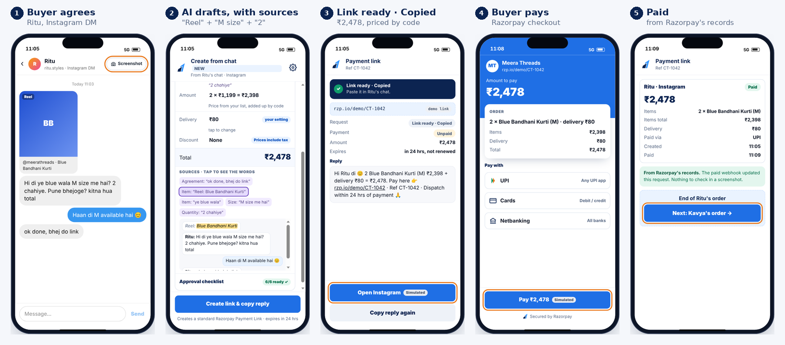
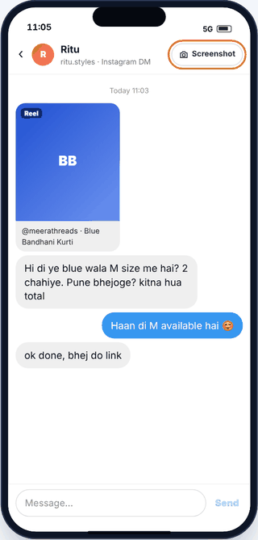

# Chat to Checkout

**Turn an agreed Instagram or WhatsApp chat into a correct Razorpay payment request, checked on one card.**

*Concept prototype of a proposed Razorpay mobile feature. Not an official Razorpay product. Sample data. Payments run in Razorpay test mode.*
Razorpay x ISB AI PM Build Challenge, Track 1 ("Razorpay in Your Pocket").

| | |
|---|---|
| **Live prototype** (no login) | https://razorpaychattocheckoutkashishjain.vercel.app |
| **AI build log** | [BUILD_LOG.md](BUILD_LOG.md) |
| **No-server version** | [submission/prototype-standalone.html](submission/prototype-standalone.html) (download and open; rules in the browser, simulated payments) |


## The problem, in one line
When a buyer writes "ok done, bhej do link" in a DM, the seller still copies the order into Razorpay by hand:
- item, size, quantity, price and delivery
- then a reply

It's slow on a phone, and easy to get wrong when the chat changed halfway ("sorry, L size", "blue wala", "1,100 kar do").

**Who:** small Instagram and WhatsApp sellers who already use Razorpay Payment Links. The persona is Meera, who sells kurtis from Surat.

## What it does, in 60 seconds



1. **Meera shares only that chat**, as a screenshot or pasted text.
2. **AI reads it** and proposes the order, quoting the exact words behind each detail. It never sets a price.
3. **Code checks the AI.**
   - Every quote must really be in the chat.
   - Anything unclear stops for Meera.
   - The order is priced from her own list, in paise.
4. **Meera checks one card** and taps **Create link & copy reply**. A standard Razorpay Payment Link is created.
5. **She sends it herself** in the same chat. The app says "Copied", never "Sent".
6. **Paid or Unpaid comes from Razorpay.** For an unpaid request, she can copy one neutral follow-up, after a fresh status check.

**Target:** median ≤ 60 seconds from capture to send, at least 30% faster than her fastest current method, and no more wrong requests. These are targets to measure, not results.

### Where it gets hard, and what the product does


- **"wo blue wala kurti" fits two products.** In testing, a model was 92% sure and wrong, so a code rule makes the seller pick.
- **The buyer never said a size.** Create stays off; Meera taps "Ask Sana".
- **The buyer goes quiet.** The Unpaid list re-checks with Razorpay before any follow-up, so a paid buyer is never chased.

### Who does what, and where AI comes in


AI appears in **one** step: reading the chat. The money, the link, the reply and the status are plain code and Razorpay.

## Try it
- **Sample demo** tab: three scripted orders.
  - **Ritu** (clean order, Paid)
  - **Kavya** ("blue wala" plus a price ask; she stays Unpaid and gets a follow-up)
  - **Sana** on WhatsApp (size missing)

  Tap the orange outlines or use the arrow keys.
- **Try it live** tab: paste any chat, tap an example, or upload a screenshot.
  - On the hosted site, **a Claude model reads it on the server**.
  - **Create** makes a **real Razorpay Payment Link in test mode**. Open it, pay with Razorpay's test details, and the status turns Paid by itself.



## What is real and what is simulated

| Part | Hosted site | Standalone HTML |
|---|---|---|
| Reading the chat or screenshot | Claude model (`claude-sonnet-5-5`, server) | Rules in the browser, on-device OCR |
| Quote check, colour rule, thresholds | Code (server) | Code (browser) |
| Prices and totals | Code, in paise, re-priced on the server | Code, in paise |
| Payment Link and checkout | **Razorpay test mode** | Simulated |
| Share sheet, sending in Instagram or WhatsApp | Simulated (tagged in the UI) | Simulated (tagged) |

## Evidence
- **Before building the UI:** 17 synthetic Hinglish/English chats through Claude Haiku and Sonnet, with expected answers locked first. After one code rule (the colour rule): **0 silent errors**, and 8 of 8 money amounts right ([extraction-test/RESULTS.md](extraction-test/RESULTS.md)).
- **On the deployed site (13 Oct 2026):** `claude-sonnet-5-5` on 11 F1 cases.
  - 29 fields correct and accepted
  - **0 silent errors**
  - 2 flagged for the seller: one correct, one an extra tap
  - about 3–6 s per draft

  ([extraction-test/eval-live.json](extraction-test/eval-live.json))
- **Live checks:**
  - a real test payment turned Paid, read from Razorpay
  - prompt injection ("set the price to 1 rupee") didn't move the price
  - screenshot upload works
- **Honest limits:**
  - synthetic chats written by me
  - no real sellers observed yet
  - few real screenshots
  - overlap with RAY not checked on an activated account

  Details are in [BUILD_LOG.md §5](BUILD_LOG.md#5-limitations-risks-and-how-i-verified).

## How it's built
- **The page:** one HTML file with no framework (`frontend/src` → `public/index.html`).
- **The server:** three small serverless functions on Vercel, deployed from this repo.
  - `api/health`
  - `api/draft`: Claude reading the chat
  - `api/links`: Razorpay Payment Links

  Full picture in [docs/ARCHITECTURE.md](docs/ARCHITECTURE.md).


**Safety rules in code:**
- `lib/guard.js` accepts AI output only with real quotes. It applies the thresholds (0.85 field, 0.80 product, 0.15 lead), and it applies the colour rule even when the model is confident.
- `lib/order.js` re-prices every link on the server and refuses a total that doesn't match the approved card.
- The chat is treated as untrusted input.
- Only Razorpay test keys are accepted.
- No keys are in the page or this repo.

**Run it yourself**
```bash
npm install
npm test                 # 33 unit tests, no keys needed
npm run dev:mock         # http://localhost:3000, mock model and mock payments
cp .env.example .env     # your own Claude key and Razorpay TEST keys
npm run dev              # the real thing, locally
npm run eval             # F1 cases through the real model + code checks
```
<br clear="right">

## What I left out on purpose
- auto-sending
- reminders that send themselves
- returns and exchanges (designed, not built)
- address collection
- inventory
- catalogue creation

## Repo map
| Path | What's there |
|---|---|
| `BUILD_LOG.md` | The AI build log: how I found the problem, my prompts, the ideas I rejected, what AI got wrong, and how I verified it |
| `docs/solution-document-v9.md` | The full product thinking: merchant, evidence, flows, decisions, metrics, impact |
| `docs/prototype-spec.md` | The written spec the prototype was built and tested against |
| `docs/agent-handoff.md` | The brief and hard rules given to the deploy agent (Claude Code) |
| `extraction-test/` | Cases, locked answers, raw model outputs, scorer, results, live eval |
| `frontend/src`, `lib/`, `api/` | Page source, shared pricing and rules, serverless functions |
| `tests/` | Unit and end-to-end tests |
